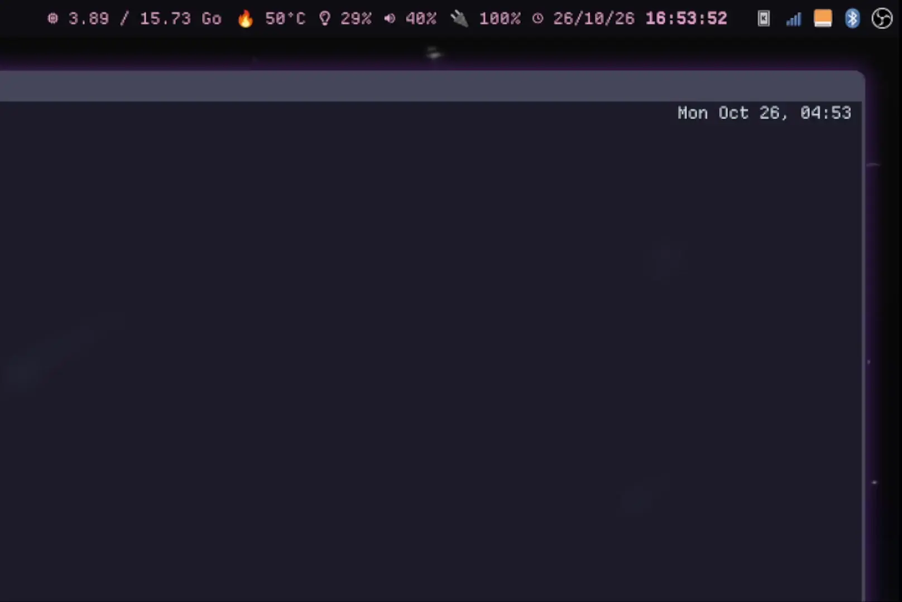

# MiniScr



MiniScr is an alternative to `Greenshot` on Windows but for Linux.

It should work on most x11 desktop environment but it is a bit more finicky on Wayland due to its abysmal obsession on breaking most apps for security's sake.

## Setup

Get the `.deb` file from the release then

```sh
$ sudo apt install ./miniscr_0.1.0_all.deb
```

## Shortcuts

To start the software you have to set it up in you WM, we don't do that for you.

Exemple for sway:
```
bindsym $mod+s miniscr -m region
bindsym $mod+Shift+s miniscr -m window
bindsym $mod+Ctrl+s miniscr -m monitor
```

When the context menu shows up, you have the following shortcuts:
- Escape: Close without doing anything
- c: Copy to clipboard
- s: Save to the default file location
- u: Upload to the first upload destination

## Config

The config is split into two files, both located by default at `~/.config/miniscr`.

The base folder can be changed by setting the `MINISCR_CONFIG_PATH` environment variable.

The first file is `config.json` and contains the following (default values):
```json
{
    "secrets_path": "", // Optional, defaults to [BASE_CONFIG_DIR]/secrets.json
    "save_directory": "~/Pictures",
    "filename_format": "screenshot_%Y%m%d_%H%M%S",
    "picture_format": "png", // Supports png, jpg or webp
    "upload_destination": [ // Default to empty
        {
            "type": "slink",
            "name": "My self-hosted image repository",
            "args": {
                "base_url": "https://slink.example.com",
                "api_key": "my api key",
                "collection_id": "my collection id", // optional, only if you want to auto-assign a collection to your screenshot
                "hide_user_agent": false // optional, default false, won't send the user agent
            }
        },
        {
            "type": "imgbb",
            "name": "Imgbb",
            "args": {
                "api_key": "my api key",
                "expiration": null, // Optional, in seconds between 60 and 15552000 (6 month)
                "hide_user_agent": false // optional, default false, won't send the user agent
            }
        },
        {
            "type": "catbox",
            "name": "Catbox",
            "args": {
                "userhash": "", // Optional, link uploads to your catbox account, uploads are anonymous otherwise
                "hide_user_agent": false // optional, default false, won't send the user agent
            }
        }
    ]
}
```

The second file is the secret file. It is useful when you want to commit your dotfiles, you can just exclude this file.

In the `upload_destination` section, every `args` value can start with `secrets:` which lets you retrieve a secret from this simple store.

Exemple:
In config, define an api key that comes from the secrets:
```json
{
    [...],
    "args": {
        "base_url": "secrets:my-slink-url",
        "api_key": "secrets:my-api-key"
    }
}
```

Then in the secrets file add it:
```json
{
    "my-slink-url": "https://slink.example.com",
    "my-api-key": "Actual api key value"
}
```

## Supported Wayland WM

- Hyprland: Should work on a standard setup.
- SwayFX: Currently requires [this PR](https://github.com/wlrfx/swayfx/pull/619) to get the cursor position.

## Additional piece of software required

List of debian package, you should adapt to your distribution if you're not running debian.

On wayland you also need:
- slurp
- grim
- wl-copy
- notify-send
- python3-gi
- gir1.2-gtk-4.0
- gir1.2-gtk4layershell-1.0

On x11 you also need:
- [equivalent to slurp]
- [equivalent to grip]
- [equivalent to wl-copy]
- notify-send

## Contributing

This project runs the `uv` project manager, you should use it.


Do not forget to update the `README.md` to add instructions for your contribution.


### Add a supported WM

To add a supported window manager, you need to implement the WM abstract class in the `wm` package.


There are two sub-class that pre-fills some generic methods: `Wayland` and `X11` so you should probably extend them.


Finally, you need to add your WM to the registered wm in the `supported_wms` array in `wm/__init__.py`.

### Add a supported upload destination

If your favorite image host is not available, you can add it by extending the class `UploadDestination` in the `destinations` package.


Then you just have to add it to the registered destinations in the `upload_destinations` array in `destinations/__init__.py`. It also should be added to the `config/upload_destination.py` type and valid_types list so that it is recognized by the config.

## AI Usage

This project is **NOT** vibe-coded. It has really low AI usage (basically I had a side chatgpt chat that helped me sometime but no agentic workflow or generated code > ~10 lines). It is written by hand and properly reviewed.

## LICENSE

```
MiniScr - A simple screenshotting tool for Linux
Copyright (C) 2026 - Oxodao


This program is free software: you can redistribute it and/or modify
it under the terms of the GNU General Public License as published by
the Free Software Foundation, either version 3 of the License, or
(at your option) any later version.


This program is distributed in the hope that it will be useful,
but WITHOUT ANY WARRANTY; without even the implied warranty of
MERCHANTABILITY or FITNESS FOR A PARTICULAR PURPOSE.  See the
GNU General Public License for more details.


You should have received a copy of the GNU General Public License
along with this program.  If not, see <http://www.gnu.org/licenses/>.
```
